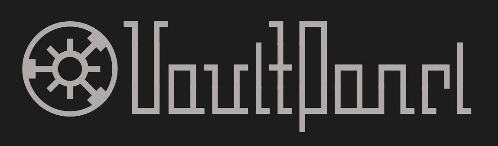

# VaultPanel



[Project website](https://gc2k10.github.io/VaultPanel/about.html) · [Interactive demo](https://gc2k10.github.io/VaultPanel/)

A self-hosted infrastructure dashboard for Raspberry Pi and home servers.

VaultPanel aims to bring storage, services, networking, hardware health and alerts into a single responsive interface.

## Try the frontend demo

[Open the live demo](https://gc2k10.github.io/VaultPanel/), or run this from the repository root with Python 3:

```sh
python3 -m http.server 8000 --bind 127.0.0.1 --directory frontend
```

Open http://127.0.0.1:8000. No device connection or credentials are needed. All readings are synthetic.

The `v0.1.0-demo` prerelease is prepared as a draft. See the [quick-start guide](docs/demo-start.md), [verified test scope](docs/demo-validation.md) and [release notes](docs/releases/v0.1.0-demo.md).

## Project status

Early public repository. A local Flask prototype has been reported; public application code, installation and feature availability have not yet been verified. The following is the intended scope, not a claim of released functionality.

## Planned capabilities

| Module | Scope |
|---|---|
| Overview | System health and resource usage |
| Storage | RAID, Btrfs, capacity and snapshots |
| Services | Service status and controlled actions |
| Network | Connectivity and network service health |
| Hardware | UPS, cooling, RGB and OLED monitoring |
| Alerts | Health warnings and event history |

## Target architecture

Python / Flask backend, modular system collectors, responsive web frontend and narrowly scoped administrative actions. The public implementation will use sanitized example configurations and synthetic demonstration data.

## Installation

A tested installation guide is not yet available. Do not deploy unverified code on a production NAS. A clean Raspberry Pi OS installation, non-root service account and documented rollback procedure are release requirements.

## Security

Never expose the administration interface directly to the internet. Do not publish credentials, private network details or production logs. Administrative actions must be authenticated and explicitly authorized.

## Roadmap

1. Inventory and sanitize the existing prototype.
2. Establish a reproducible installation and read-only monitoring.
3. Build and test the responsive dashboard.
4. Add narrowly scoped controls and automated tests.
5. Publish a documented release.

## License and support

Licensed under the [MIT License](LICENSE). Optional support: [Buy Me a Coffee](https://buymeacoffee.com/gc2k10f). No payment is required to view this repository.

